# OVXR sample gallery

Choose a sample by what you want to learn, preview its output, then open its
run instructions or give its adaptation guide to your coding assistant.
The public source checkout includes these images for offline viewing. The SDK
package keeps the runnable samples and skills but omits gallery media; its
gallery entrypoint links to the online gallery.

These are actual left-eye captures from Python samples running in the
bundled OpenXR emulator. Eleven samples also have C++ versions; the
three OVUI samples currently use Python. Captures show virtual scene rendering,
not physical headset validation or real-world passthrough. See the
[validation checklist](../VALIDATION.md) for headset checks and platform limits.

**App types:** most samples use **stereo VR**. AR blending demonstrates a
transparent-background AR scene; view configuration exposes mono/stereo/AUTO.
Minimal XR also exposes runtime-dependent AR/blend options. The PiP image and
desktop mirrors are mono views of a stereo app. The [per-sample compatibility matrix](../COMPATIBILITY.md)
lists display, VR/AR and input limits. The three OVUI samples currently require
opaque panels, scene depth, one GPU and disabled foveation.

GIFs show short, slowed sequences so interactions are easy to follow. Static
PNGs remain available for closer inspection or viewers without animation support.

| Sample | What it teaches | Languages |
| --- | --- | --- |
| [Minimal XR](#minimal-xr) | Load a scene and submit stereo frames. | C++ and Python |
| [Live scene](#live-scene) | Publish scene animation alongside XR camera updates. | C++ and Python |
| [Anchors and teleport](#anchors-and-teleport) | Place, move and reset the tracking origin. | C++ and Python |
| [Foveation](#foveation) | Compare full-resolution and foveated rendering. | C++ and Python |
| [Frame capture and PiP](#frame-capture-and-pip) | Preview a separate camera view on desktop and in XR; optionally capture an eye and save. | C++ and Python |
| [Runtime lifecycle](#runtime-lifecycle) | Diagnose setup and recreate an XR session. | C++ and Python |
| [Spatial workbench](#spatial-workbench) | Controller/hand input, scene tools and navigation. | C++ and Python |
| [OVUI panel](#ovui-panel) | Render and interact with OVUI controls in XR. | Python |
| [Scene inspector](#scene-inspector) | Select objects, edit transforms and share undo/redo. | Python |
| [Spatial UI](#spatial-ui) | Move panels by their headers and route input by depth. | Python |
| [AR blending](#ar-blending) | Distinguish transparent background, opaque objects and environment blending. | C++ and Python |
| [View configuration](#view-configuration) | Select mono/stereo/AUTO and inspect negotiated views. | C++ and Python |
| [Asynchronous capture](#asynchronous-capture) | Copy owned images to a bounded slow-consumer queue. | C++ and Python |

Start with **Minimal XR** for session setup or **OVUI panel** for UI integration.
The later **Spatial UI** sample adds just two behaviors to the panel example.
The workbench and inspector combine more features.

## Minimal XR

Load a USD scene, create an OpenXR session, submit stereo frames and shut down
cleanly. This capture uses the default robot exhibition scene from its start
pose: on the floor 1 m from the robot, facing it. Your own USD scene can
replace it. If the robot cannot load, a bundled room is used; select it directly with `--offline`.

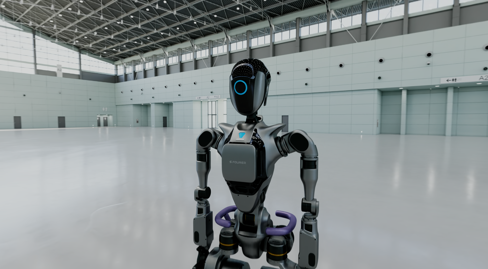

[Python source and run instructions](../python/minimal-xr/README.md) ·
[C++ source and run instructions](../c/minimal-xr/README.md) ·
[Adaptation guide](../python/minimal-xr/README.md#adapting-this-sample)

## Live scene

Animate the orange cube directly in OVStage while OVXR updates the eye cameras.
The cube moves and rotates; both changes are published through the application's
frame loop.

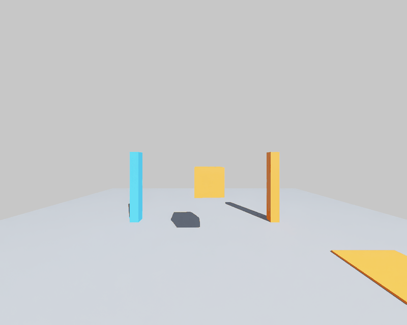

[Still image](images/live-scene.png).

[Python source and run instructions](../python/live-scene/README.md) ·
[C++ source and run instructions](../c/live-scene/README.md) ·
[Adaptation guide](../python/live-scene/README.md#adapting-this-sample)

## Anchors and teleport

Move the tracking origin to a new position and heading. The room stays in
place while the viewpoint changes. The sample also follows a moving scene
anchor and resets to the stage origin.

[Starting view](images/anchors-start.png) · [After teleport](images/anchors-teleport.png).

[Python source and run instructions](../python/anchors-and-teleport/README.md) ·
[C++ source and run instructions](../c/anchors-and-teleport/README.md) ·
[Adaptation guide](../python/anchors-and-teleport/README.md#adapting-this-sample)

## Foveation

Compare full-resolution, application-controlled and runtime-provided foveation.
The fine grid exposes peripheral resampling. Open the images at full size to
compare detail; thumbnail scaling can hide or introduce apparent differences.
Local mode uses a deliberately strong **0.2 resolution multiplier / 0.1 inset**
to reveal a small sharp center and reduced detail toward the edges. These two
captures compare full-resolution and local foveation, not performance.

| Full resolution | Strong local foveation (0.2 / 0.1) |
| --- | --- |
| 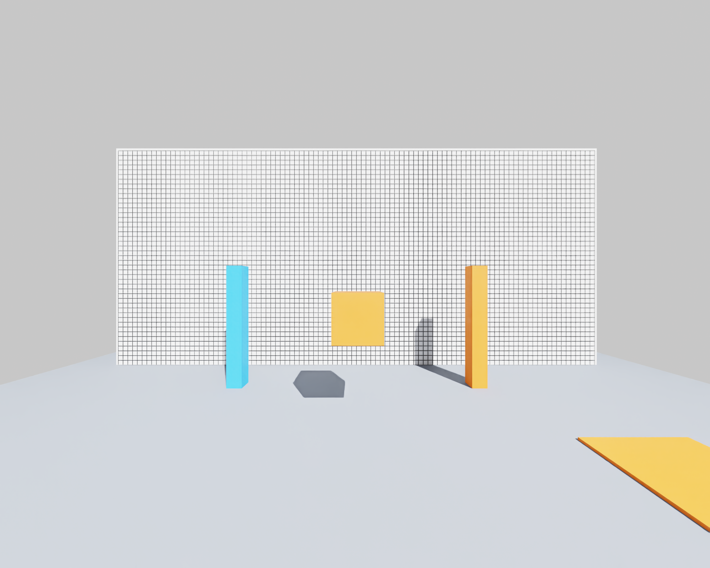 | 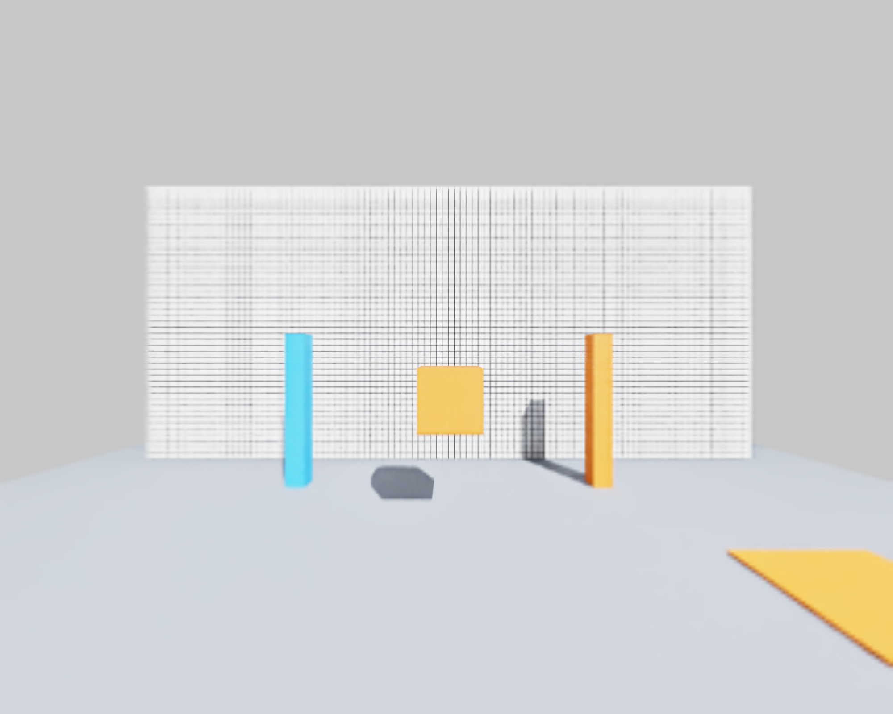 |

[Python source and run instructions](../python/foveation/README.md) ·
[C++ source and run instructions](../c/foveation/README.md) ·
[Adaptation guide](../python/foveation/README.md#adapting-this-sample)

## Frame capture and PiP

Share a **separate camera view** between a live desktop PiP window, a floating
scene panel and optional saving. The camera looks across the animated cube from
the right; the main XR view looks from the front. The panel is out of the feed
camera's view. `--source eye` retains the original eye-readback lesson.
The panel is a 128 × 96 diagnostic mesh; the observer render and its desktop/saved
output are 640 × 480. The animation shows the headset panel, not the desktop window.

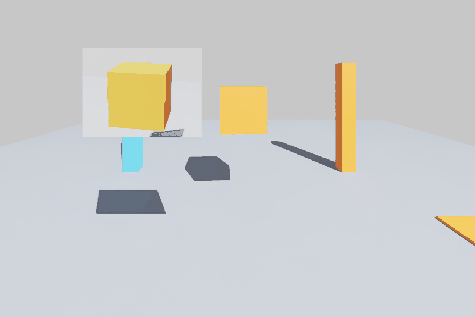

[Static preview](images/frame-capture-pip.png)

[Python source and run instructions](../python/frame-capture/README.md) ·
[C++ source and run instructions](../c/frame-capture/README.md) ·
[Adaptation guide](../python/frame-capture/README.md#adapting-this-sample)

## Runtime lifecycle

Check runtime readiness, recreate the XR context while preserving the renderer
and scene, and display a desktop mirror. This sample uses the same room below.
Its main behavior is in session transitions and diagnostics, which a still
image cannot show. A controlled restart is distinct from testing a real
CloudXR client or network disconnect.

[Python source and run instructions](../python/runtime-lifecycle/README.md) ·
[C++ source and run instructions](../c/runtime-lifecycle/README.md) ·
[Adaptation guide](../python/runtime-lifecycle/README.md#adapting-this-sample)

## Spatial workbench

Use controllers or tracked hands to select and grab objects, edit the scene,
undo, teleport and snap-turn. The foreground controls are scene geometry, with
a violet occluder blocking some controls. This is the broader interaction
example. In demo mode two stylized hands have joint spheres, connecting finger
cylinders and rounded palms, including a thumb/index pinch. The magenta beam
starts at the right index tip and follows the actual input ray; its white tip
marks the nearest hit. Demo hands and rays are
synthetic and do not prove tracked input.

The 13.4-second loop includes 96 captured frames so you can follow the beam,
pinch, scene edits and teleport. Playback is slowed for inspection.

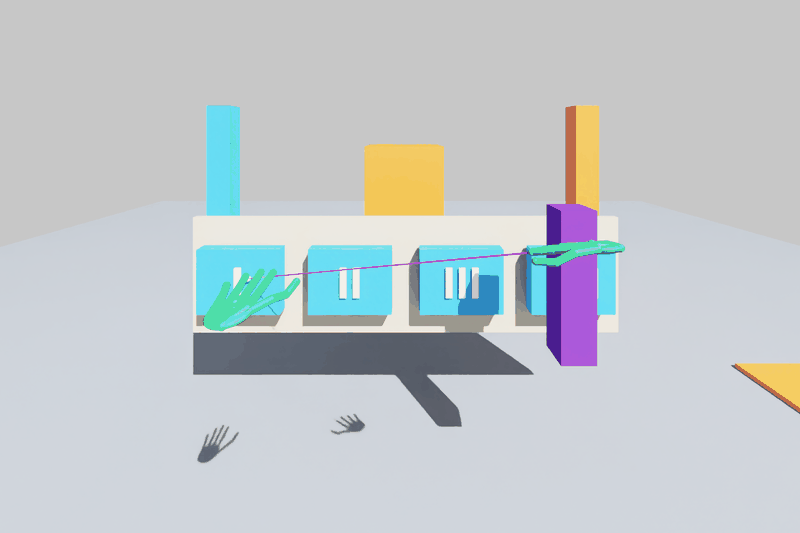

Colors identify roles: **mint hands**, **magenta ray**, **white hit marker**,
**cyan controls**, **violet occluder** and **amber cube**. The light ivory backing
panel separates the cyan buttons and their white markings from dark cast shadows.

Follow the first sequence: move the cube left, rotate it, try undo through the
occluder (blocked), pinch and drag the cube, then point at the floor to teleport.

[Static preview](images/spatial-workbench.png)

[Python source and run instructions](../python/spatial-workbench/README.md) ·
[C++ source and run instructions](../c/spatial-workbench/README.md) ·
[Adaptation guide](../python/spatial-workbench/README.md#adapting-this-sample)

## OVUI panel

Project native OVUI controls into each eye image: a pause button, speed slider
and pointer feedback. The cube passes in front of the panel's lower portion,
hiding its pixels and blocking input there while leaving the main controls
and pointing beam visible. The initial bridge uses opaque panels, required
scene depth, disabled foveation and one GPU.

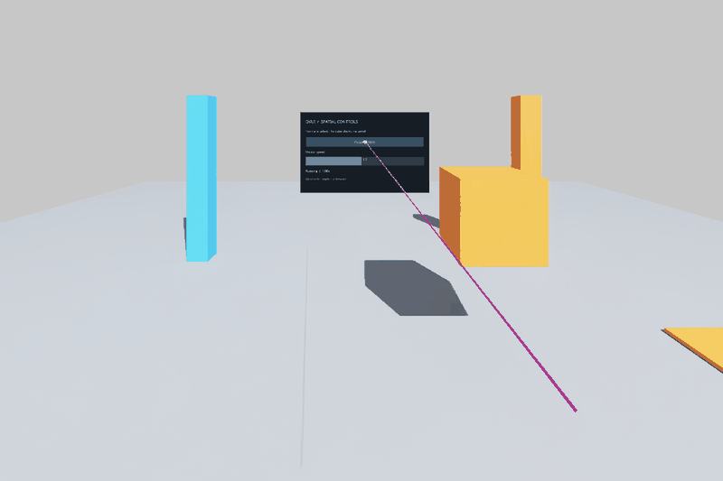

[Clear panel](images/ovui-panel.png) · [Occluded panel](images/ovui-panel-occluded.png).

[Python source and run instructions](../python/ovui-panel/README.md) ·
[Adaptation guide](../python/ovui-panel/README.md#adapting-this-sample)

## Scene inspector

Select a part through XR pointing or the OVUI list, edit position, rotation and
scale, and use shared undo/redo/reset. The blue cube's outline identifies the
selection. Desktop shortcuts and XR controls act on the same application model.

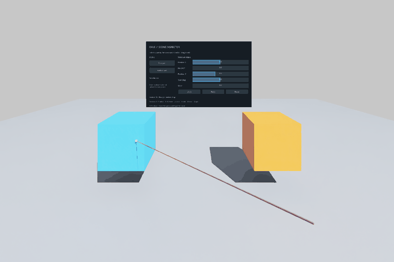

[Static preview](images/scene-inspector.png)

[Python source and run instructions](../python/scene-inspector/README.md) ·
[Adaptation guide](../python/scene-inspector/README.md#adapting-this-sample)

## Spatial UI

Two small panels, one button each. Drag panel A by its header to expose panel B.
Only the nearest visible panel receives input, and the cube still blocks part
of B. This sample adds header movement and multiple-panel ordering; panel
rotation, resizing and controller/wrist attachment are separate future work.

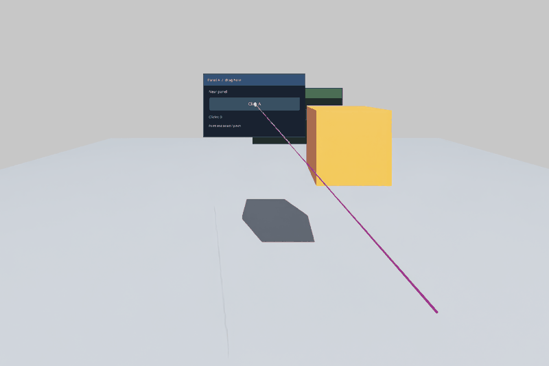

[Moved panel](images/spatial-ui-moved.png) · [Overlapping panels](images/spatial-ui-overlap.png).

[Python source and run instructions](../python/spatial-ui/README.md) ·
[Adaptation guide](../python/spatial-ui/README.md#adapting-this-sample)

## AR blending

An amber sphere and a dark opaque cube float against a transparent background.
Compare requested and resolved environment blending and inspect alpha counts.
The preview contains virtual objects only; it does not show headset passthrough.

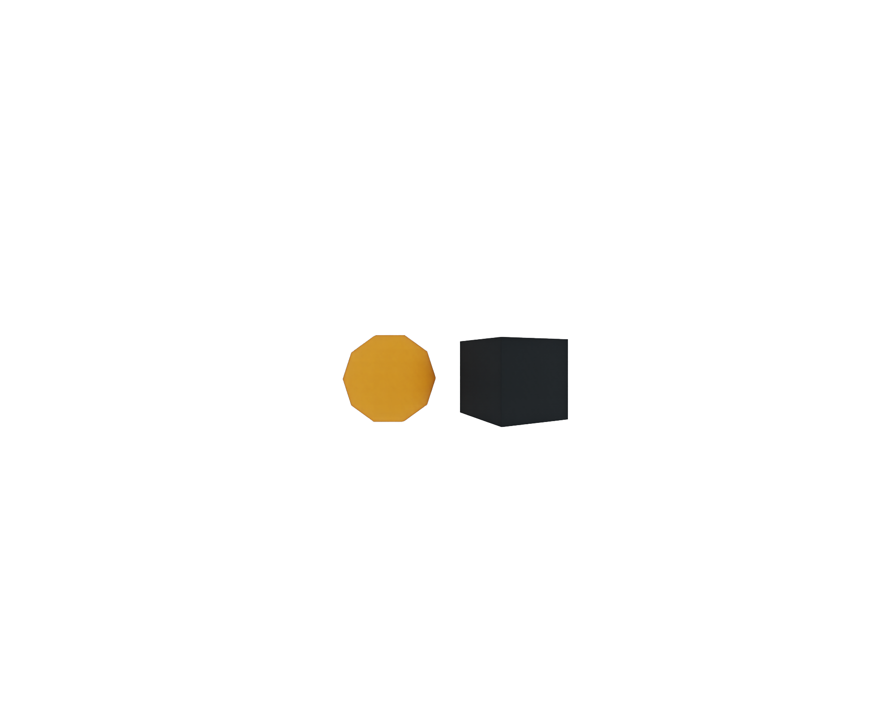

[C++](../c/ar-blending/README.md) · [Python](../python/ar-blending/README.md) ·
[Adaptation guide](../python/ar-blending/README.md#adapting-this-sample)

## View configuration

The same room can use mono, stereo or AUTO, subject to runtime support. The
report shows resolved view count and actual view-0 image dimensions. This static
stereo-session eye capture cannot establish mono support on a physical headset.

[C++](../c/view-configuration/README.md) · [Python](../python/view-configuration/README.md) ·
[Adaptation guide](../python/view-configuration/README.md#adapting-this-sample)

## Asynchronous capture

XR renders the room while a slower worker consumes owned eye images. The final
report shows offered, consumed and dropped frames; a screenshot shows the
captured scene, while those counters demonstrate the asynchronous behavior.

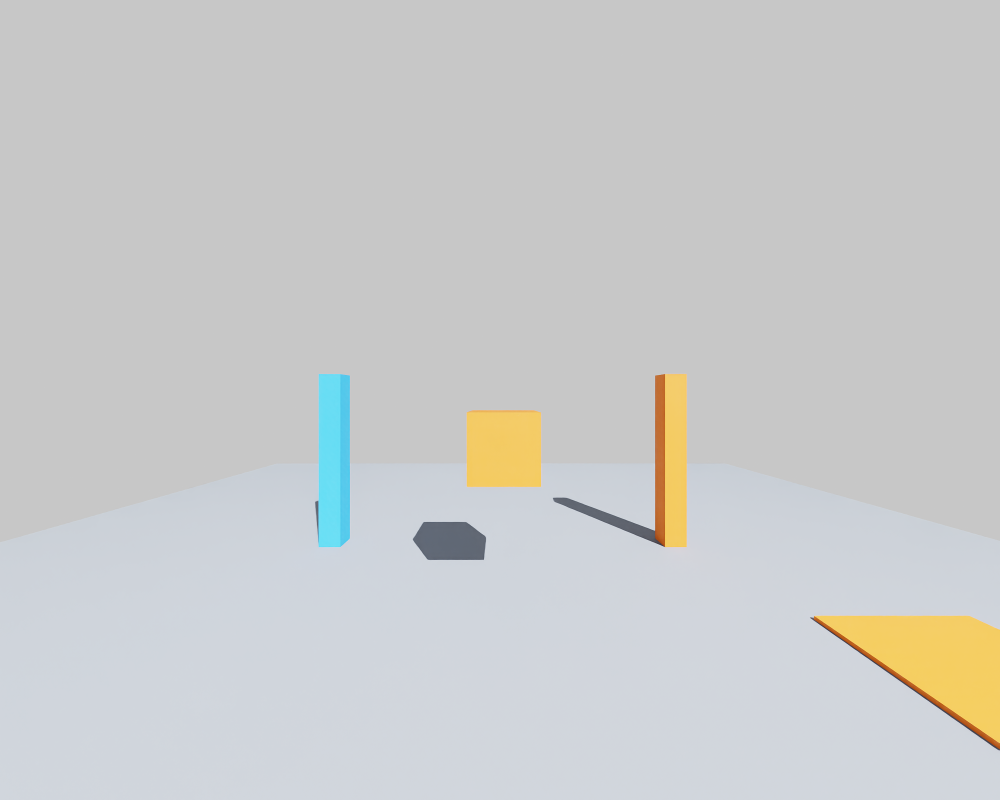

[C++](../c/async-capture/README.md) · [Python](../python/async-capture/README.md) ·
[Adaptation guide](../python/async-capture/README.md#adapting-this-sample)

[All sample instructions](../README.md) · [All adaptation guides](../README.md#skills-by-sample)
